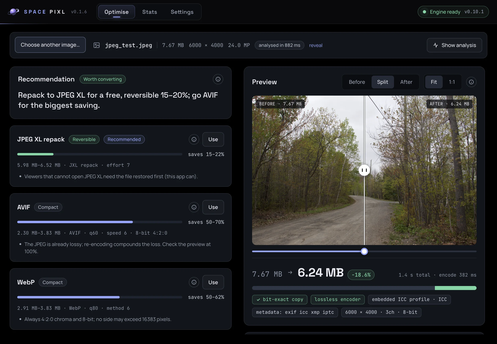
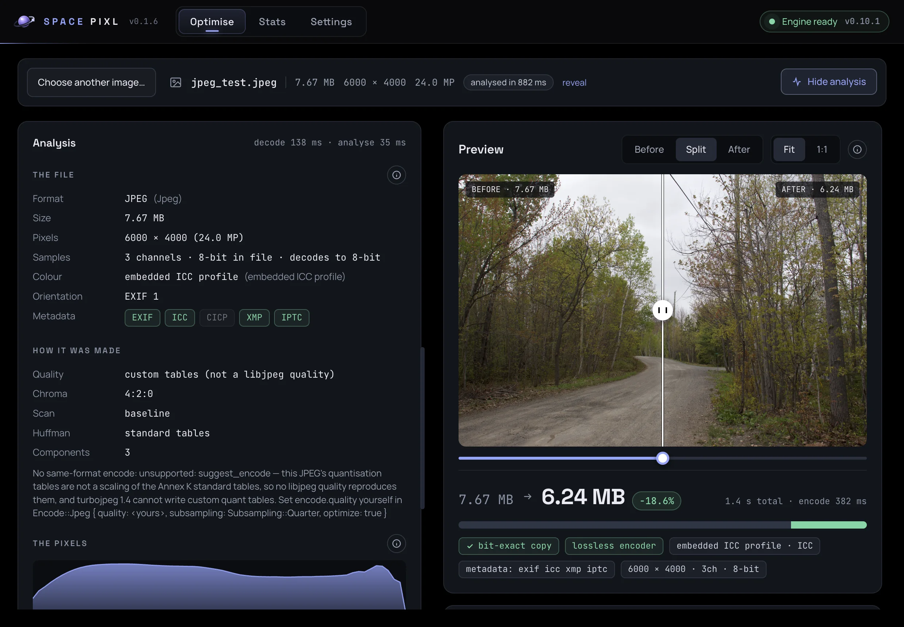
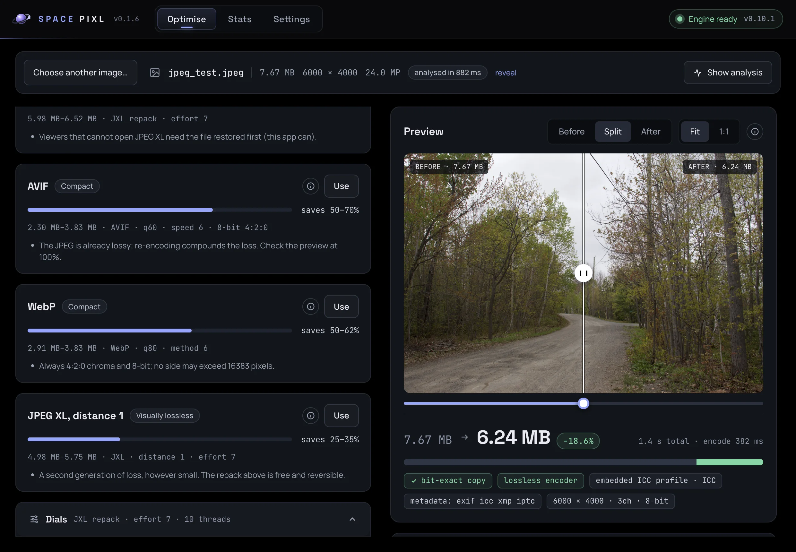
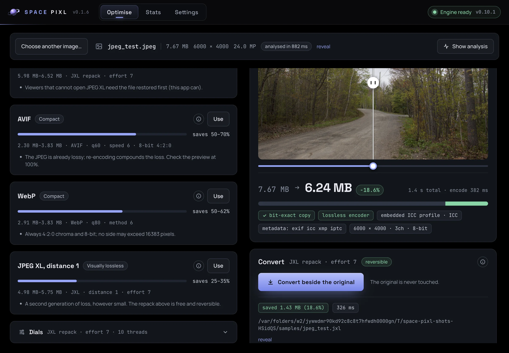
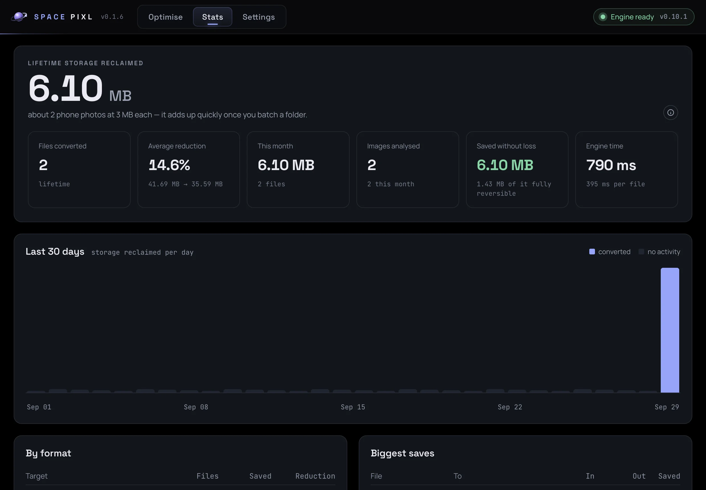

<picture>
  <source media="(prefers-color-scheme: dark)" srcset="docs/readme/logo-dark.svg"/>
  
</picture>

**More space. Same pixels.**

   

[space.pixlfoundation.com](https://space.pixlfoundation.com) · [Tour and savings calculator](https://xuckless.github.io/space-pixl/) · [Install](docs/install.md) · [Releases](https://github.com/xuckless/space-pixl/releases/latest)

**Download:** [macOS · Apple silicon](https://github.com/xuckless/space-pixl/releases/latest/download/space-pixl-mac-arm64.dmg) · [macOS · Intel](https://github.com/xuckless/space-pixl/releases/latest/download/space-pixl-mac-x64.dmg) · [Windows x64](https://github.com/xuckless/space-pixl/releases/latest/download/space-pixl-win-x64-setup.exe)

 

Space Pixl measures every photo in a folder, recommends only the conversions that save space, previews the real result, and writes the smaller file beside the original, never over it.

## The size you see is the real file

Every candidate is actually encoded before you commit, so a bad trade is visible up front. A JPEG XL repack takes about a fifth off any JPEG and can be undone byte for byte; AVIF saves the most; HEIC can make a file bigger, and the app says so.

The full table, measured on an M2 Pro: [What you save](docs/savings.md)

## In the app

<table>
  <tr>
    <td width="50%"> <b>Analysis.</b> What the file is, how it was made, what its pixels look like.</td>
    <td width="50%"> <b>Dials.</b> Every encoder setting, resize, depth, metadata and colour.</td>
  </tr>
  <tr>
    <td> <b>Converted.</b> Saved 1.43 MB (18.6%), written beside the original.</td>
    <td> <b>Stats.</b> Storage reclaimed, per day, by format, biggest wins.</td>
  </tr>
</table>

## Install

Download the installer for your computer above. Builds are not code-signed yet, so macOS needs one Terminal line the first time and Windows SmartScreen asks once: [step-by-step install](docs/install.md). The app updates itself; Linux is not shipped.

## Built on the PIXL engine

Space Pixl is the storage half of the [PIXL engine](https://engine.pixlfoundation.com): it reads, analyses and re-encodes, and leaves grading to [Pixl Playroom](https://github.com/xuckless/pixl-playroom), the photo developer on the same engine. The engine makes no decisions of its own; every recommendation you see is the app's, and every number is the engine's report.

## License

Copyright © 2026 xuckless. All rights reserved. This source is published for reference only ([LICENSE](LICENSE)) and cannot be built without the PIXL engine, a separate, closed component distributed only as compiled binaries. The app ships with its [licence agreement](legal/EULA.md), [privacy policy](legal/PRIVACY.md) and [third-party notices](build/THIRD_PARTY_NOTICES.txt).
